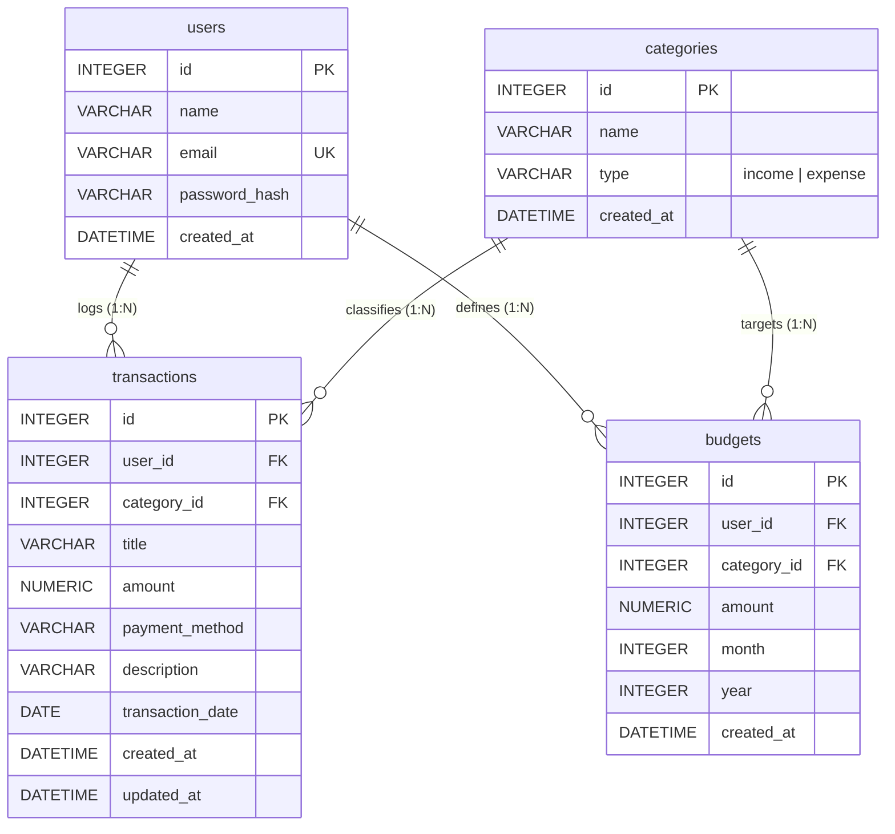

# Database Schema Specification
## Personal Finance & Expense Tracker Web Application

---

## 1. Overview & Data Architecture Principles
- **Document Version:** 1.0.0
- **Document Status:** Approved / Source of Truth for Database Implementation
- **Target Engine:** SQLite 3 (via Flask-SQLAlchemy)
- **Primary Design Principles:**
  - **Relational Integrity:** Strictly four core application tables: `users`, `categories`, `transactions`, and `budgets`.
  - **Single Source of Truth:** Transaction type (`income` vs. `expense`) is strictly derived from the linked `categories.type`. No redundant type column exists on the `transactions` table.
  - **Decimal Financial Storage:** All monetary fields use `Numeric(10, 2)` (mapped to Python `decimal.Decimal`) to prevent floating-point calculation inaccuracies.
  - **Referential Integrity:** Enforce SQLite foreign key constraints via `PRAGMA foreign_keys = ON` on all engine connections.
  - **Shared Lookup Categories:** Categories serve as shared system lookup records seeded idempotently, eliminating category duplication across individual user accounts.
  - **Tenant Data Isolation:** User-owned tables (`transactions`, `budgets`) maintain a mandatory foreign key to `users.id` and are indexed for optimal tenant-scoped queries.

---

## 2. Table Specifications

### 2.1 Table: `users`
Stores registered user accounts, authentication credentials, and user metadata.

| Column | Type | Nullable | Constraints & Defaults | Description |
|---|---|---|---|---|
| `id` | `INTEGER` | `NOT NULL` | `PRIMARY KEY AUTOINCREMENT` | Unique identifier for each user |
| `name` | `VARCHAR(100)` | `NOT NULL` | — | User's full display name |
| `email` | `VARCHAR(120)` | `NOT NULL` | `UNIQUE` | User's login email address (case-insensitive lookup) |
| `password_hash` | `VARCHAR(255)` | `NOT NULL` | — | Cryptographically hashed password (PBKDF2/Scrypt) |
| `created_at` | `DATETIME` | `NOT NULL` | `DEFAULT CURRENT_TIMESTAMP` | UTC timestamp when account was registered |

#### Constraints & Indexes
- **Unique Constraint:** `uq_users_email` ON `users(email)`
- **Index:** `ix_users_email` ON `users(email)` (automatically provided by unique constraint)

---

### 2.2 Table: `categories`
Stores shared reference lookup data for classifying transactions and defining budget categories.

| Column | Type | Nullable | Constraints & Defaults | Description |
|---|---|---|---|---|
| `id` | `INTEGER` | `NOT NULL` | `PRIMARY KEY AUTOINCREMENT` | Unique identifier for each category |
| `name` | `VARCHAR(50)` | `NOT NULL` | — | Category title (e.g., "Food", "Salary") |
| `type` | `VARCHAR(10)` | `NOT NULL` | `CHECK (type IN ('income', 'expense'))` | Direction of cash flow |
| `created_at` | `DATETIME` | `NOT NULL` | `DEFAULT CURRENT_TIMESTAMP` | UTC timestamp when category was seeded |

#### Constraints & Indexes
- **Unique Constraint:** `uq_categories_name_type` ON `categories(name, type)`
  - Ensures a category name is unique within its type (e.g., allows "Other" for `income` and "Other" for `expense`, but prevents duplicate "Food" under `expense`).
- **Check Constraint:** `ck_categories_type` CHECK (`type IN ('income', 'expense')`)
- **Index:** `ix_categories_type` ON `categories(type)` to accelerate filtering categories by type.

---

### 2.3 Table: `transactions`
Records atomic cash flow movements (inflows and outflows) for authenticated users.

| Column | Type | Nullable | Constraints & Defaults | Description |
|---|---|---|---|---|
| `id` | `INTEGER` | `NOT NULL` | `PRIMARY KEY AUTOINCREMENT` | Unique transaction ID |
| `user_id` | `INTEGER` | `NOT NULL` | `FOREIGN KEY -> users(id) ON DELETE CASCADE` | Owning user identifier |
| `category_id` | `INTEGER` | `NOT NULL` | `FOREIGN KEY -> categories(id) ON DELETE RESTRICT` | Referenced category (determines income/expense) |
| `title` | `VARCHAR(100)` | `NOT NULL` | — | Short descriptive title of transaction |
| `amount` | `NUMERIC(10, 2)`| `NOT NULL` | `CHECK (amount > 0.00)` | Transaction monetary value ($> 0.00$) |
| `payment_method` | `VARCHAR(50)` | `NOT NULL` | — | Method used (Cash, Debit Card, Credit Card, etc.) |
| `description` | `VARCHAR(255)` | `NULL` | — | Optional transaction notes or remarks |
| `transaction_date`| `DATE` | `NOT NULL` | — | Calendar date of transaction (`YYYY-MM-DD`) |
| `created_at` | `DATETIME` | `NOT NULL` | `DEFAULT CURRENT_TIMESTAMP` | UTC creation timestamp |
| `updated_at` | `DATETIME` | `NOT NULL` | `DEFAULT CURRENT_TIMESTAMP` | UTC timestamp of last update |

#### Constraints & Indexes
- **Check Constraint:** `ck_transactions_amount` CHECK (`amount > 0.00`)
- **Composite Index:** `ix_transactions_user_date` ON `transactions(user_id, transaction_date DESC)`
  - Critical performance index: powers dashboard month filtering, recent transactions, 6-month aggregations, and sorted transaction ledger queries.
- **Index:** `ix_transactions_user_category` ON `transactions(user_id, category_id)`
  - Powers budget actual-spent computations and category-wise report breakdowns.

---

### 2.4 Table: `budgets`
Defines monthly spending limits set by users on specific expense categories.

| Column | Type | Nullable | Constraints & Defaults | Description |
|---|---|---|---|---|
| `id` | `INTEGER` | `NOT NULL` | `PRIMARY KEY AUTOINCREMENT` | Unique budget ID |
| `user_id` | `INTEGER` | `NOT NULL` | `FOREIGN KEY -> users(id) ON DELETE CASCADE` | Owning user identifier |
| `category_id` | `INTEGER` | `NOT NULL` | `FOREIGN KEY -> categories(id) ON DELETE RESTRICT` | Targeted expense category |
| `amount` | `NUMERIC(10, 2)`| `NOT NULL` | `CHECK (amount > 0.00)` | Budget spending limit ($> 0.00$) |
| `month` | `INTEGER` | `NOT NULL` | `CHECK (month BETWEEN 1 AND 12)` | Calendar month (1–12) |
| `year` | `INTEGER` | `NOT NULL` | `CHECK (year >= 2000)` | 4-digit calendar year (e.g., 2026) |
| `created_at` | `DATETIME` | `NOT NULL` | `DEFAULT CURRENT_TIMESTAMP` | UTC creation timestamp |

#### Constraints & Indexes
- **Unique Constraint:** `uq_budgets_user_cat_month_year` ON `budgets(user_id, category_id, month, year)`
  - Strictly prevents multiple active budgets for the same user, category, and month/year combination.
- **Check Constraints:**
  - `ck_budgets_amount` CHECK (`amount > 0.00`)
  - `ck_budgets_month` CHECK (`month >= 1 AND month <= 12`)
  - `ck_budgets_year` CHECK (`year >= 2000`)
- **Index:** `ix_budgets_user_period` ON `budgets(user_id, year, month)`
  - Powers budget dashboard and budget summary queries for a specific month/year.

---

## 3. Entity-Relationship Diagram (ERD)



---

## 4. Referential Integrity & Cascade Deletion Rules

### 4.1 Relationship Cardinalities
1. **`User` to `Transaction` (`1 : N`):** One user owns zero or more transactions.
2. **`User` to `Budget` (`1 : N`):** One user owns zero or more monthly budgets.
3. **`Category` to `Transaction` (`1 : N`):** One category classifies zero or more transactions.
4. **`Category` to `Budget` (`1 : N`):** One category is the spending target of zero or more budgets.

### 4.2 Deletion & Foreign Key Cascades
- **`users.id` Deletion (`ON DELETE CASCADE`):**
  - If a user record is deleted, all transactions and budgets belonging to that user are automatically removed by the database engine, avoiding orphaned records.
- **`categories.id` Deletion (`ON DELETE RESTRICT`):**
  - A category record cannot be deleted if any transaction or budget references its `category_id`. The database engine and application logic reject deletion requests to preserve historical audit trails.
- **Protection of Shared Default Categories:**
  - Shared categories are static system lookups and are not deletable through any user-facing UI route.

---

## 5. Seed Data & Idempotent Initialization

### 5.1 System Categories List
The application includes a standard, comprehensive set of default categories:

#### Expense Categories (`type = 'expense'`):
1. `Food`
2. `Transport`
3. `Shopping`
4. `Entertainment`
5. `Education`
6. `Bills`
7. `Healthcare`
8. `Travel`
9. `Other`

#### Income Categories (`type = 'income'`):
1. `Salary`
2. `Freelance`
3. `Scholarship`
4. `Allowance`
5. `Investment`
6. `Other`

*(Note: The name `Other` exists legitimately under both `income` and `expense`, satisfying the composite unique constraint `(name, type)`).*

### 5.2 Idempotent Seeding Logic
Seeding occurs automatically when initializing the database or during application setup. If a category with the same `(name, type)` already exists, it is skipped without throwing an error:

```python
DEFAULT_CATEGORIES = [
    # Expense categories
    ("Food", "expense"),
    ("Transport", "expense"),
    ("Shopping", "expense"),
    ("Entertainment", "expense"),
    ("Education", "expense"),
    ("Bills", "expense"),
    ("Healthcare", "expense"),
    ("Travel", "expense"),
    ("Other", "expense"),
    # Income categories
    ("Salary", "income"),
    ("Freelance", "income"),
    ("Scholarship", "income"),
    ("Allowance", "income"),
    ("Investment", "income"),
    ("Other", "income"),
]

def seed_categories(db_session):
    for name, cat_type in DEFAULT_CATEGORIES:
        exists = Category.query.filter_by(name=name, type=cat_type).first()
        if not exists:
            db_session.add(Category(name=name, type=cat_type))
    db_session.commit()
```

---

## 6. Implementation Notes for Flask-SQLAlchemy

### 6.1 Model Definitions Pattern
```python
from datetime import datetime, timezone
from decimal import Decimal
from app.extensions import db
from flask_login import UserMixin
from werkzeug.security import generate_password_hash, check_password_hash

class User(UserMixin, db.Model):
    __tablename__ = 'users'

    id = db.Column(db.Integer, primary_key=True)
    name = db.Column(db.String(100), nullable=False)
    email = db.Column(db.String(120), unique=True, nullable=False, index=True)
    password_hash = db.Column(db.String(255), nullable=False)
    created_at = db.Column(db.DateTime, nullable=False, default=lambda: datetime.now(timezone.utc))

    transactions = db.relationship('Transaction', backref='user', lazy='dynamic', cascade='all, delete-orphan')
    budgets = db.relationship('Budget', backref='user', lazy='dynamic', cascade='all, delete-orphan')

    def set_password(self, password):
        self.password_hash = generate_password_hash(password)

    def check_password(self, password):
        return check_password_hash(self.password_hash, password)


class Category(db.Model):
    __tablename__ = 'categories'

    id = db.Column(db.Integer, primary_key=True)
    name = db.Column(db.String(50), nullable=False)
    type = db.Column(db.String(10), nullable=False, index=True)
    created_at = db.Column(db.DateTime, nullable=False, default=lambda: datetime.now(timezone.utc))

    transactions = db.relationship('Transaction', backref='category', lazy='dynamic')
    budgets = db.relationship('Budget', backref='category', lazy='dynamic')

    __table_args__ = (
        db.UniqueConstraint('name', 'type', name='uq_categories_name_type'),
        db.CheckConstraint("type IN ('income', 'expense')", name='ck_categories_type'),
    )


class Transaction(db.Model):
    __tablename__ = 'transactions'

    id = db.Column(db.Integer, primary_key=True)
    user_id = db.Column(db.Integer, db.ForeignKey('users.id', ondelete='CASCADE'), nullable=False)
    category_id = db.Column(db.Integer, db.ForeignKey('categories.id', ondelete='RESTRICT'), nullable=False)
    title = db.Column(db.String(100), nullable=False)
    amount = db.Column(db.Numeric(10, 2, asdecimal=True), nullable=False)
    payment_method = db.Column(db.String(50), nullable=False)
    description = db.Column(db.String(255), nullable=True)
    transaction_date = db.Column(db.Date, nullable=False)
    created_at = db.Column(db.DateTime, nullable=False, default=lambda: datetime.now(timezone.utc))
    updated_at = db.Column(db.DateTime, nullable=False, default=lambda: datetime.now(timezone.utc), onupdate=lambda: datetime.now(timezone.utc))

    __table_args__ = (
        db.CheckConstraint('amount > 0.00', name='ck_transactions_amount'),
        db.Index('ix_transactions_user_date', 'user_id', db.text('transaction_date DESC')),
        db.Index('ix_transactions_user_category', 'user_id', 'category_id'),
    )

    @property
    def transaction_type(self):
        """Derived dynamically from the associated category's type."""
        return self.category.type if self.category else None


class Budget(db.Model):
    __tablename__ = 'budgets'

    id = db.Column(db.Integer, primary_key=True)
    user_id = db.Column(db.Integer, db.ForeignKey('users.id', ondelete='CASCADE'), nullable=False)
    category_id = db.Column(db.Integer, db.ForeignKey('categories.id', ondelete='RESTRICT'), nullable=False)
    amount = db.Column(db.Numeric(10, 2, asdecimal=True), nullable=False)
    month = db.Column(db.Integer, nullable=False)
    year = db.Column(db.Integer, nullable=False)
    created_at = db.Column(db.DateTime, nullable=False, default=lambda: datetime.now(timezone.utc))

    __table_args__ = (
        db.UniqueConstraint('user_id', 'category_id', 'month', 'year', name='uq_budgets_user_cat_month_year'),
        db.CheckConstraint('amount > 0.00', name='ck_budgets_amount'),
        db.CheckConstraint('month >= 1 AND month <= 12', name='ck_budgets_month'),
        db.CheckConstraint('year >= 2000', name='ck_budgets_year'),
        db.Index('ix_budgets_user_period', 'user_id', 'year', 'month'),
    )
```

### 6.2 SQLite Foreign Key Connection Listener
In `app/__init__.py` or `app/extensions.py`, register the connection hook to enforce foreign key constraints in SQLite:
```python
from sqlalchemy import event
from sqlalchemy.engine import Engine

@event.listens_for(Engine, "connect")
def set_sqlite_pragma(dbapi_connection, connection_record):
    cursor = dbapi_connection.cursor()
    cursor.execute("PRAGMA foreign_keys=ON")
    cursor.close()
```

### 6.3 Database Initialization CLI
A simple helper command or startup hook in `run.py` initializes the database without requiring complex third-party migration tools:
```python
# Initialization workflow in run.py
with app.app_context():
    db.create_all()
    seed_categories(db.session)
```

---

## 7. Document Reconciliation & Alignment Notes

During the compilation of this schema against earlier planning documents, the following refinements are explicitly documented:

1. **Category Ownership (Shared vs. Per-User):**
   - *Earlier Document (`PRD.md` Section 5.2):* Suggested categories might carry a `user_id` foreign key.
   - *Refined Specification (`DATABASE.md` & Prompt 04):* Categories are explicitly defined as **shared lookup reference data** (`categories` table has no `user_id`). This dramatically simplifies the schema, avoids duplicating identical default categories across dozens of user accounts, and prevents user-modified category names from disrupting shared report groupings. Custom user-owned categories are not introduced.
2. **Category Names & Types:**
   - Default categories are finalized to 9 Expense categories and 6 Income categories with lowercase `type` values (`'income'`, `'expense'`), standardizing consistency between HTML form controls and database constraints.
3. **Derived Transaction Types:**
   - Reconfirmed that `transactions` has **no** `transaction_type` column; type is always derived from `categories.type`.
